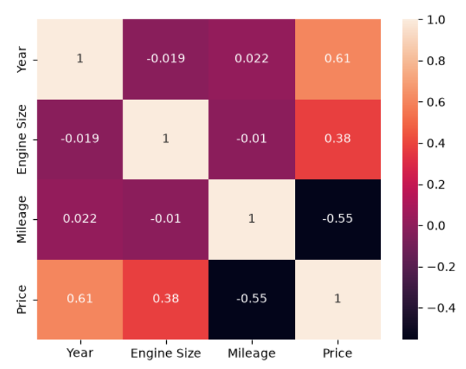
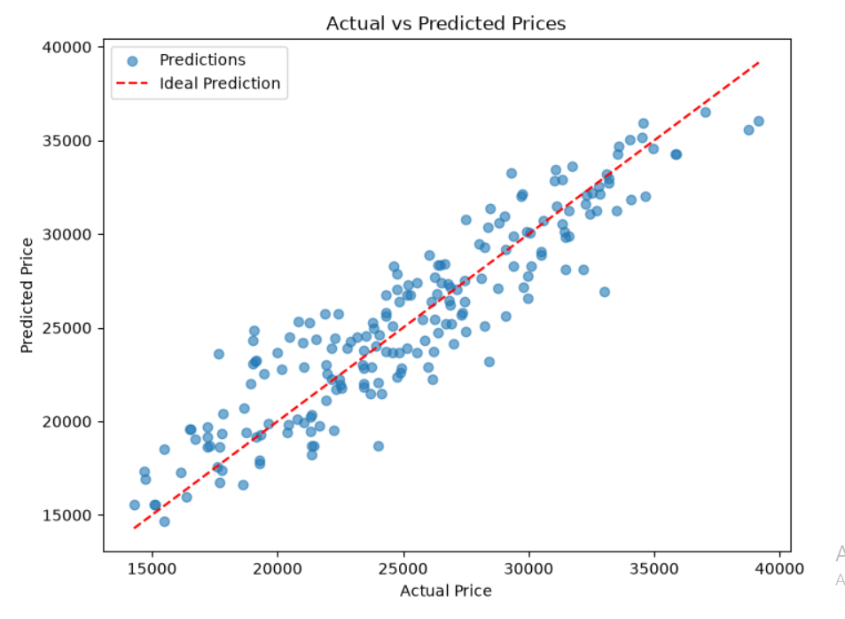
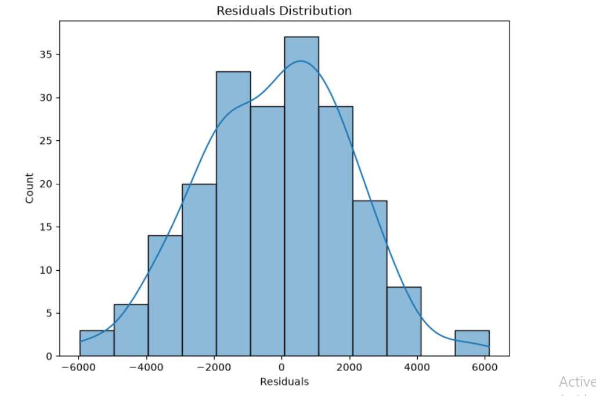

# Car Price Prediction Using Linear Regression

## Project Overview

This project aims to analyze car-related data and develop a Machine Learning model to predict car prices based on different features.

It follows a complete Machine Learning workflow, from data understanding and cleaning to model training and evaluation.

## Objectives

- Understand and explore the dataset.
- Clean and prepare the data.
- Perform Exploratory Data Analysis (EDA).
- Analyze relationships between car features and prices.
- Build a Linear Regression model.
- Evaluate model performance.
- Compare the model with a baseline predictor.

## Dataset Description

The dataset contains 1,000 car records and 8 columns.

| Feature | Description |
|---|---|
| Make | Car manufacturer |
| Model | Car model |
| Year | Manufacturing year |
| Engine Size | Engine size |
| Mileage | Distance driven |
| Fuel Type | Type of fuel |
| Transmission | Transmission type |
| Price | Car price (Target Variable) |

**Target Variable:** `Price`

## Project Structure

```text
Car-Price-Prediction/
│
├── data/
│   ├── raw/
│   └── processed/
│
├── notebooks/
│   ├── 01_data_exploration.ipynb
│   ├── 02_data_cleaning.ipynb
│   ├── 03_EDA.ipynb
│   ├── 04_linear_regression.ipynb
│   └── 05_model_evaluation.ipynb
│
├── models/
│   └── linear_regression.pkl
│
├── images/
│   ├── actual_vs_predicted.png
│   ├── correlation_heatmap.png
│   └── residuals_distribution.png
│
├── requirements.txt
└── README.md
```

## Exploratory Data Analysis

Several visualizations were created to understand the dataset and identify patterns in car prices.

### 1. Correlation Heatmap

The heatmap illustrates the correlation between numerical features and helps identify potential relationships with the target variable.



## Model Evaluation

The Linear Regression model was evaluated using an independent test dataset.

### 2. Actual vs Predicted Prices

This visualization compares actual car prices with the prices predicted by the model.



### 2. Residuals Distribution

Residual plots help analyze residuals distribution.



## Model Performance

The current Linear Regression model achieved the following results:

| Metric | Result |
|---|---:|
| MAE | 1,751.83 |
| MSE | 4,684,620.29 |
| RMSE | 2,164.40 |
| R² Score | 0.8418 |

The model explains approximately 84.18% of the variance in car prices on the test dataset.

*Note: These results correspond to the current dataset preprocessing and model configuration.*

## Project Workflow

1. **Data Understanding:** Inspect dataset structure, features, and descriptive statistics.
2. **Data Cleaning:** Check missing values, duplicates, and potential outliers.
3. **Exploratory Data Analysis:** Explore feature distributions, correlations, and relationships with Price.
4. **Feature Engineering and Model Training:** Preprocess numerical and categorical features, then train a Linear Regression model.
5. **Model Evaluation:** Evaluate predictions using regression metrics and residual analysis, and compare against a DummyRegressor baseline.

## Technologies and Libraries

- Python
- Pandas
- NumPy
- Matplotlib
- Seaborn
- Scikit-learn
- Joblib
- Jupyter Notebook

## How to Run the Project

### 1. Clone the Repository

```bash
git clone YOUR_GITHUB_REPOSITORY_URL
```

### 2. Navigate to the Project Directory

```bash
cd Car-Price-Prediction
```

### 3. Create a Virtual Environment

```bash
python -m venv venv
```

### 4. Activate the Environment

Windows:

```bash
venv\Scripts\activate
```

macOS/Linux:

```bash
source venv/bin/activate
```

### 5. Install Dependencies

```bash
pip install -r requirements.txt
```

### 6. Run Jupyter Notebook

```bash
jupyter notebook
```

Run the notebooks in numerical order, starting with Data Understanding and ending with Model Evaluation.

## Future Improvements

- Experiment with additional regression algorithms.
- Improve feature engineering.
- Perform more extensive hyperparameter tuning.
- Compare multiple Machine Learning models.
- Deploy the trained model using an API.

## Author

**Hiba**

Machine Learning Portfolio Project — Car Price Prediction.

